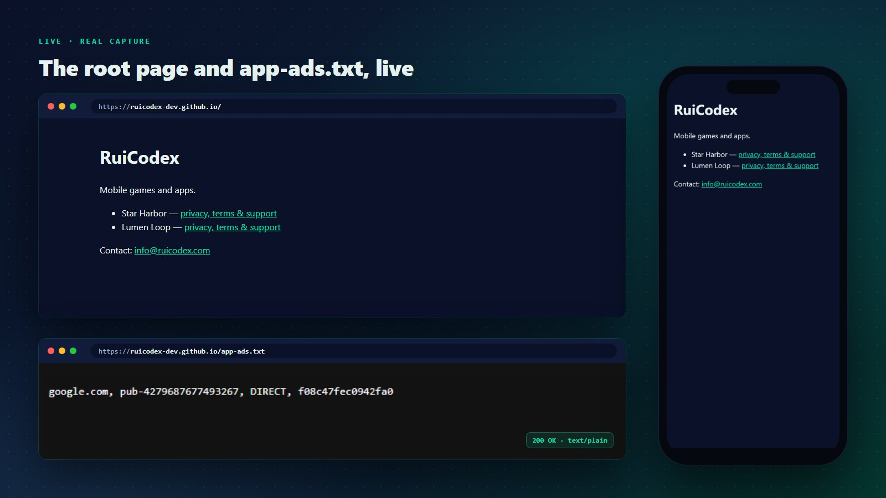
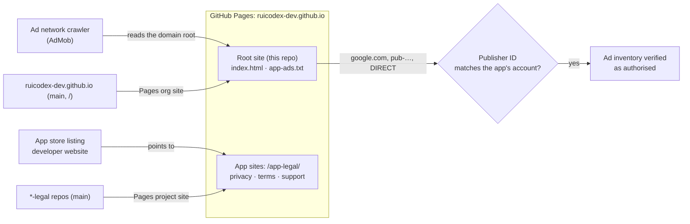
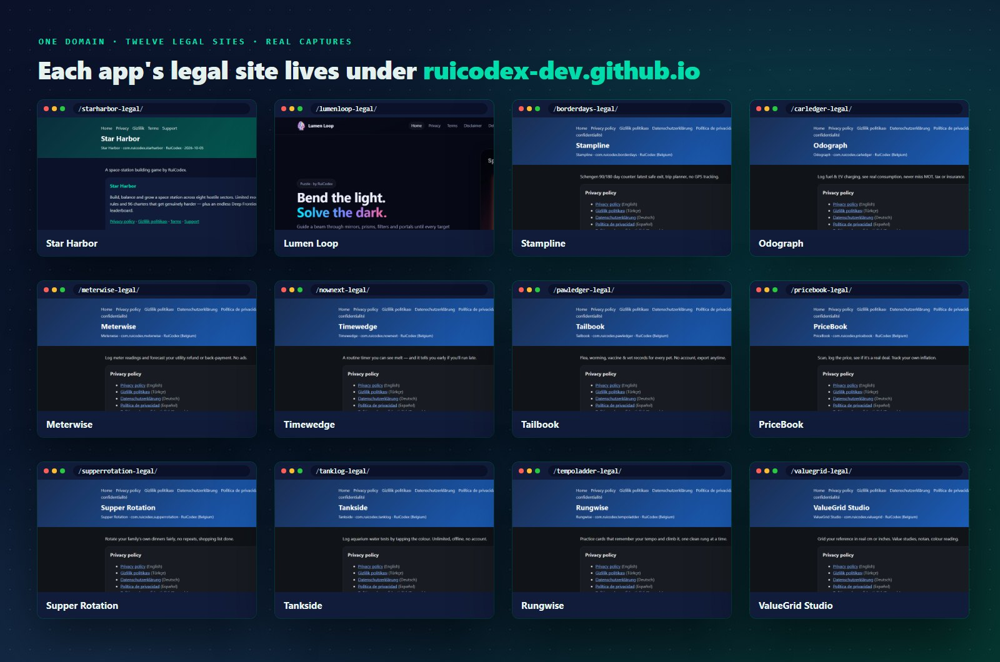

<div align="center">

<a href="https://ruicodex-dev.github.io/">
  <picture>
    
  </picture>
</a>

### The root of `ruicodex-dev.github.io`: one landing page, one `app-ads.txt`, and the domain every Rui Codex app site lives under.


**[Live site](https://ruicodex-dev.github.io/)** &nbsp;·&nbsp;
[app-ads.txt](https://ruicodex-dev.github.io/app-ads.txt) &nbsp;·&nbsp;
[Sites on this domain](#sites-on-this-domain) &nbsp;·&nbsp;
[Edit app-ads.txt](#editing-app-adstxt) &nbsp;·&nbsp;
[Rui Codex](https://ruicodex.com)

</div>

<br>

<p align="center">
  <a href="https://ruicodex-dev.github.io/">
    
  </a>
  <br>
  <sub>The live root page on desktop and phone, and <code>/app-ads.txt</code> as the ad crawler sees it. Real captures, taken 2026-10-28.</sub>
</p>

## What this is

This repository is the **organisation site** of the `RuiCodex-dev` GitHub org. Because it is named `ruicodex-dev.github.io`,
GitHub Pages serves it at the **root** of that domain, straight from `main` (no build step, no Jekyll).

It has one job that no other repo can do: put an **`app-ads.txt`** file at `https://ruicodex-dev.github.io/app-ads.txt`.
Ad networks read that file from the root of the developer website named in an app's store listing, and the Rui Codex app sites
(Privacy, Terms and Support pages) are GitHub Pages **project** sites such as `/lumenloop-legal/`, which can only serve files
under their own sub-path. This repo fills the root, so those apps have a valid `app-ads.txt` on the same domain.

<table>
  <tr>
    <td width="33%" valign="top">📄 <b>app-ads.txt at the root</b><br>One authorised-seller line for Google AdMob, served as <code>text/plain</code> with HTTP 200.</td>
    <td width="33%" valign="top">🌳 <b>One domain, many sites</b><br>Every project site in the org with Pages enabled appears under <code>ruicodex-dev.github.io/&lt;repo&gt;/</code>.</td>
    <td width="33%" valign="top">🧭 <b>A tiny landing page</b><br><code>index.html</code> names Rui Codex, links the Star Harbor and Lumen Loop legal sites and gives a contact address.</td>
  </tr>
  <tr>
    <td width="33%" valign="top">⚡ <b>Zero build</b><br>Three files. <code>.nojekyll</code> tells Pages to publish them exactly as they are.</td>
    <td width="33%" valign="top">🔒 <b>HTTPS enforced</b><br>Served by GitHub Pages with HTTPS on, no custom domain and no third-party scripts.</td>
    <td width="33%" valign="top">🌗 <b>Same look as the app sites</b><br>Navy <code>#0a1128</code> with teal <code>#00e0b0</code> links, the palette the <code>*-legal</code> sites share.</td>
  </tr>
</table>

## The file that matters

<p align="center">
  
  <br>
  <sub>A real session against the live site (2026-10-28), replayed as an SVG.</sub>
</p>

`app-ads.txt` follows the IAB Tech Lab format: one line per authorised seller, four comma-separated fields.

| Field | Value in this file | Meaning |
|---|---|---|
| Ad system domain | `google.com` | The ad network (Google AdMob) |
| Publisher account ID | `pub-4279687677493267` | The Rui Codex AdMob publisher account |
| Relationship | `DIRECT` | The publisher controls this account itself, no reseller |
| Certification authority ID | `f08c47fec0942fa0` | Google's TAG ID |

## How it works



## Sites on this domain

Each app's Privacy, Terms and Support pages live in their own public `*-legal` repository and are served under this domain.
The root page links Star Harbor and Lumen Loop; the others are reached directly or from their store listings.

<p align="center">
  
  <br>
  <sub>Home pages of the twelve app sites, captured live on 2026-10-28.</sub>
</p>

| App | What it is (from its site) | Site |
|---|---|---|
| **Star Harbor** | A space-station building game by Rui Codex. | [/starharbor-legal/](https://ruicodex-dev.github.io/starharbor-legal/) |
| **Lumen Loop** | Bend, split and mix light through 280 hand-tuned puzzles; daily puzzles, missions and a calm Zen mode. | [/lumenloop-legal/](https://ruicodex-dev.github.io/lumenloop-legal/) |
| **Stampline** | Schengen 90/180 day counter: latest safe exit, trip planner, no GPS tracking. | [/borderdays-legal/](https://ruicodex-dev.github.io/borderdays-legal/) |
| **Odograph** | Log fuel and EV charging, see real consumption, never miss MOT, tax or insurance. | [/carledger-legal/](https://ruicodex-dev.github.io/carledger-legal/) |
| **Meterwise** | Log meter readings and forecast your utility refund or back-payment. No ads. | [/meterwise-legal/](https://ruicodex-dev.github.io/meterwise-legal/) |
| **Timewedge** | A routine timer you can see melt, and it tells you early if you will run late. | [/nownext-legal/](https://ruicodex-dev.github.io/nownext-legal/) |
| **Tailbook** | Flea, worming, vaccine and vet records for every pet. No account, export anytime. | [/pawledger-legal/](https://ruicodex-dev.github.io/pawledger-legal/) |
| **PriceBook** | Scan, log the price, see if it is a real deal. Track your own inflation. | [/pricebook-legal/](https://ruicodex-dev.github.io/pricebook-legal/) |
| **Supper Rotation** | Rotate your family's own dinners fairly, no repeats, shopping list done. | [/supperrotation-legal/](https://ruicodex-dev.github.io/supperrotation-legal/) |
| **Tankside** | Log aquarium water tests by tapping the colour. Unlimited, offline, no account. | [/tanklog-legal/](https://ruicodex-dev.github.io/tanklog-legal/) |
| **Rungwise** | Practice cards that remember your tempo and climb it, one clean rung at a time. | [/tempoladder-legal/](https://ruicodex-dev.github.io/tempoladder-legal/) |
| **ValueGrid Studio** | Grid your reference in real cm or inches. Value studies, notan, colour reading. | [/valuegrid-legal/](https://ruicodex-dev.github.io/valuegrid-legal/) |

## Tech stack

| Layer | Choice |
|---|---|
| Hosting | GitHub Pages, organisation site, source `main` / root, HTTPS enforced |
| Pages | One hand-written `index.html` with inline CSS (system font stack), no JavaScript |
| Ads verification | `app-ads.txt` (IAB Tech Lab format), Google AdMob seller line |
| Build | None. `.nojekyll` disables Jekyll so files are published as-is |

## Getting started

**Prerequisites:** Git, plus Python 3 (or any static file server) for a local preview.

```bash
git clone https://github.com/RuiCodex-dev/ruicodex-dev.github.io.git
cd ruicodex-dev.github.io
python -m http.server 8000        # then open http://localhost:8000/
```

Check what the live site serves:

```bash
curl -s  https://ruicodex-dev.github.io/app-ads.txt
curl -sI https://ruicodex-dev.github.io/app-ads.txt | grep -iE "^(HTTP|content-type)"
```

Publishing is a push to `main`: GitHub Pages redeploys the site on its own.

### Editing app-ads.txt

1. Add or change one line per seller: `<ad system domain>, <publisher id>, <DIRECT|RESELLER>[, <certification id>]`.
   A mediation partner gives you its exact line; paste it unchanged.
2. Keep the file at the repository root, plain text, UTF-8, named exactly `app-ads.txt`.
3. Push to `main`, wait for the Pages deploy, then confirm with the `curl` commands above.
4. In AdMob, open the app's **app-ads.txt** status and let it re-check; crawlers revisit on their own schedule.

### Adding an app to the landing page

Add one `<li>` to the list in `index.html`, linking the app's project site (for example `newapp-legal/`). The project site
itself lives in its own `<app>-legal` repository with Pages enabled; it appears under this domain automatically.

## Project structure

```text
ruicodex-dev.github.io/
├── index.html      # root landing page: Rui Codex, links to app legal sites, contact
├── app-ads.txt     # authorised ad sellers (Google AdMob)
├── .nojekyll       # publish files as-is, skip Jekyll
└── docs/media/     # README banner, badges and captures (not linked from the site)
```

## FAQ

<details>
<summary><b>Why does app-ads.txt live here and not in each app's legal repo?</b></summary>
<br>
Ad networks look for <code>app-ads.txt</code> at the root of the developer website's domain, for example
<code>https://ruicodex-dev.github.io/app-ads.txt</code>. A project site such as <code>/lumenloop-legal/</code> can only publish
files under its own path, so only the organisation site (this repo) can serve the root file.
</details>

<details>
<summary><b>Is the publisher ID a secret?</b></summary>
<br>
No. An <code>app-ads.txt</code> file is public by design: ad buyers read it to confirm who may sell an app's inventory.
It contains no keys or credentials.
</details>

<details>
<summary><b>Why is there a <code>.nojekyll</code> file?</b></summary>
<br>
Without it GitHub Pages runs Jekyll, which skips some files and processes others. The empty <code>.nojekyll</code> file makes
Pages publish the repository exactly as committed.
</details>

<details>
<summary><b>Does changing this repo affect the app sites?</b></summary>
<br>
Only the root (<code>/</code>, <code>/index.html</code>, <code>/app-ads.txt</code>) comes from this repo. Each
<code>/&lt;app&gt;-legal/</code> path is built from its own repository, so edits here never change those pages.
</details>

<details>
<summary><b>Where do I report a problem with an app?</b></summary>
<br>
Use the Support page on that app's site, or write to <a href="mailto:info@ruicodex.com">info@ruicodex.com</a>.
</details>

---

<div align="center">

**All rights reserved, © 2026 Rui Codex.**

Built by **[Rui Codex](https://ruicodex.com)** &nbsp;·&nbsp; Contact: info@ruicodex.com

<sub>Media credits: all captures are real headless-Chromium screenshots of the live sites; the banner, badges and terminal replay are hand-made SVG. No generated imagery, no film (Tier C repo).</sub>

</div>
